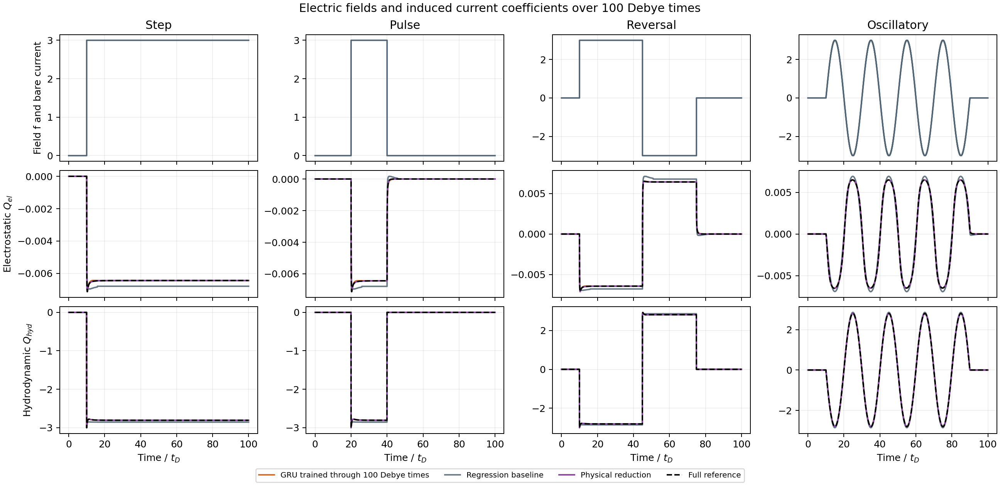
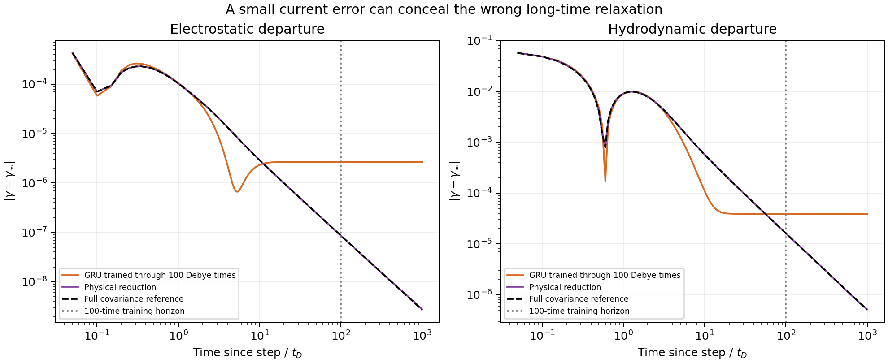

# Scientific ML for electrolyte relaxation

[](https://github.com/HBonneau/electrolyte-memory-surrogates/actions/workflows/tests.yml)

**Accurate current predictions can conceal incorrect long-time dynamics.**

A reproducible PyTorch study of field-to-current surrogates, built on my coauthored electrolyte research. It covers simulation, dataset design, causal training, and physical failure analysis.

A 3,522-parameter GRU predicts ordinary currents well, but misses their small algebraic relaxation. A controlled loss experiment and a physical reduction examine that discrepancy.

## The prediction task



Input: an electric-field history; outputs: two interaction-current coefficients. The columns show a step, pulse, reversal, and oscillating field. Time is measured in the electrolyte’s characteristic Debye relaxation time.

## Same-data comparison: regression and GRU

Both models share data, whole-history splits, and normalization. Regression uses polynomial lag features; the 32-unit GRU enforces causality, field parity, and equilibrium.

Each cell lists **electrostatic / hydrodynamic-residual NRMSE**. The hydrodynamic score excludes the known instantaneous baseline.

| Evaluation condition | Regression | Reference GRU, seed 13 |
|---|---:|---:|
| Whole 100-time histories | 6.38% / 18.10% | 0.56% / 0.62% |
| After changes (<1 Debye time) | 9.82% / 19.08% | 1.76% / 2.19% |
| Unseen waveforms | 8.14% / 27.56% | 3.55% / 5.15% |
| Larger field amplitudes | 118.41% / 116.14% | 1.91% / 2.53% |
| Late field changes | 7.23% / 22.40% | 0.48% / 1.08% |

Histories span 100 times, with training changes ending by time 10. Approximately 90% of samples follow that cutoff. The 32 additional late-change probes are evaluation-only. See [errors by regime](results/accuracy_by_regime.png) and [exact scores](results/metrics.json).

## The physical failure



All curves subtract the **same physical stationary value**. The reference decays approximately as time^(-3/2); the GRU plateaus before its 100-time training boundary. The diagnostic continues to 1,000 times. It establishes incorrect physical relaxation, without identifying decay about the network’s own limit.

## Controlled experiment: change the loss

Three paired training seeds compare MSE with MSE plus a stationary-centered late-asinh penalty. Each pair shares its warm-up state, optimizer, batches, and 20-epoch budget. Endpoints are fixed; calibration uses training data only. No exponent or inference correction is imposed.

Mean ± sample SD across three paired training seeds; each cell lists electrostatic / hydrodynamic. Tail scores use five amplitude diagnostics over times 100–1,000 and are dimensionless error ratios, not percentages.

| Continuation loss | Standard-test current NRMSE | Tail relative RMS error |
|---|---:|---:|
| MSE | 0.68 ± 0.18% / 1.00 ± 0.53% | 2605 ± 458 / 1494 ± 1120 |
| MSE + late asinh | 0.72 ± 0.24% / 1.02 ± 0.55% | 1262 ± 1409 / 1183 ± 1158 |

The penalty improved electrostatic tails in 2/3 pairs and hydrodynamic tails in 1/3. Both settings retain late plateaus; this intervention does not reliably recover the algebraic tail.

[Experiment protocol](docs/EXPERIMENT.md) · [Paired results](results/loss_ablation.json) · [Tail comparison figure](results/loss_ablation.png)

## Separate comparison: supervised physical reduction

The reduced model evolves known covariance dynamics at 288 wavevectors and learns positive integration weights. Its on/off fitting curves extend to time 1,000, providing different physical information and training data from the GRU.

| Same physical grid and held-out amplitude diagnostics | Worst tail relative RMS error |
|---|---:|
| Ordinary integration weights | 3.90% |
| Learned integration weights | 1.12% |

The retained dynamics supply the memory mechanism; learning improves its finite approximation.

## Run it

Use Python 3.11, from the repository root:

```bash
python3.11 -m venv .venv
source .venv/bin/activate
python -m pip install -e .
python -m electrolyte_surrogate.demo
python -m unittest discover -s tests -v
```

Saved data, weights, and figures are included. Training is optional; no GPU is required. The demo writes to `runs/demo/`. Reproduce all evaluations with:

```bash
python -m electrolyte_surrogate.evaluate --ablation artifacts/loss_ablation
```

For fitting, data generation, measured runtimes, and custom fields, see [REPRODUCING.md](docs/REPRODUCING.md).

## Read the code

Start with [the GRU](src/electrolyte_surrogate/model.py), [regression](src/electrolyte_surrogate/baseline.py), and [training](src/electrolyte_surrogate/train.py), then [loss calibration](src/electrolyte_surrogate/losses.py) and [the paired experiment](src/electrolyte_surrogate/ablate.py). Tests cover independent physics, causality, data separation, gradients, and saved-model accuracy.

`artifacts/` stores fitted parameters, `data/` synthetic records, and `results/` measured evidence. Fresh-checkout training reproduced every reference-GRU parameter byte. Automated checks install the package, verify data/model hashes, run tests, and exercise inference.

Labels come from a Gaussian point-ion theory. These finite-window fits establish neither experimental validity nor a general limitation of GRUs. The physical grid also eventually loses the continuum tail.

Author: Haggai Bonneau. Implementation developed with Codex assistance.

[Concise summary](docs/SUMMARY.md) · [Physical conventions and papers](docs/PHYSICS.md) · [Verification record](docs/VERIFICATION.json) · [MIT license](LICENSE)
