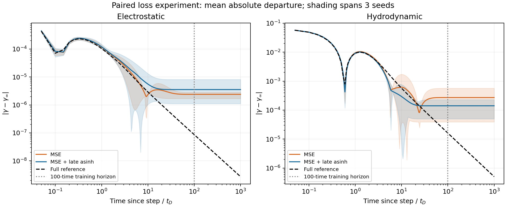

# Accurate currents can conceal incorrect relaxation

This project turns a known electrolyte theory into a controlled scientific-ML benchmark. Given an electric-field history, a surrogate predicts two interaction-current coefficients. The trusted covariance solver supplies labels and independent physical limits, allowing errors in small long-time signals to be measured directly.

The learning dataset contains 1,088 complete histories spanning 100 Debye times: 768 training, 128 validation, and 192 tests, including unseen waveform and amplitude families. Changes occur early, followed by long holds. A separate set of 32 late-change protocols tests transfer across the full window. Whole histories define the splits.

## Neural prediction and its failure

A causal 32-unit GRU enforces field parity and equilibrium. A polynomial ridge baseline uses the same records and normalization. The reference GRU's full-history electrostatic/hydrodynamic-residual NRMSE is **0.56% / 0.62%**, compared with **6.38% / 18.10%** for regression. Immediately after changes the GRU errors are **1.76% / 2.19%**; unseen waveforms give **3.55% / 5.15%**. The late-change probes give **0.48% / 1.08%**. These scores use different reference populations and should not be interpreted as matched gains between conditions.

Ordinary current accuracy conceals a larger physical error. After a sustained field step, the reference approaches stationarity approximately as time^(-3/2), but the GRU develops a biased plateau. The mismatch is visible before the 100-time training boundary and persists in the diagnostic through time 1,000. All curves subtract the same physical stationary value. Switch-off separately tests exponential relaxation and signs.

## A controlled loss intervention

Three paired training seeds compare ordinary MSE with MSE plus a stationary-centered late-asinh penalty. Each pair shares its warm-up state, optimizer moments, batch order, and full-history training budget. Both use a fixed final epoch. Calibration uses training records only; stationary coefficients enter the loss rather than the neural input or inference output.

The penalty lowered electrostatic tail error in 2/3 pairs and hydrodynamic tail error in 1/3. Both settings retain late plateaus; this intervention does not reliably recover the algebraic tail. The effect depends on the training seed and current term.

Mean ± sample SD across three paired training seeds; each cell lists electrostatic / hydrodynamic. Tail scores use five amplitude diagnostics over times 100–1,000 and are dimensionless error ratios, not percentages.

| Continuation loss | Standard-test current NRMSE | Tail relative RMS error |
|---|---:|---:|
| MSE | 0.68 ± 0.18% / 1.00 ± 0.53% | 2605 ± 458 / 1494 ± 1120 |
| MSE + late asinh | 0.72 ± 0.24% / 1.02 ± 0.55% | 1262 ± 1409 / 1183 ± 1158 |

Per-seed ordinary errors, tail errors, and paired differences are supplied alongside means and sample standard deviations. Finite-endpoint prediction error is distinguished from a genuine physical departure at that time; late prediction variation is reported separately. Three seeds describe training variability on this dataset, not general statistical confidence. [Protocol](EXPERIMENT.md) and [complete results](../results/loss_ablation.json).

## A separate physical reduction

The reduced model retains known covariance dynamics at 288 wavevectors and learns positive integration weights. This preserves a range of physical relaxation rates. Learning improves worst tail relative RMS error from **3.90% to 1.12%** on five held-out fitting amplitudes over times 10–1,000, compared with ordinary weights on the same grid.

This model receives known dynamics and longer on/off fitting curves. Its success demonstrates supervised physical reduction and is presented separately from the data-matched regression/GRU comparison. A finite mode grid also eventually loses the continuum algebraic law.

The useful ML result is a reproducible training/evaluation workflow that exposes physical failures hidden by aggregate scores. All labels are synthetic Gaussian point-ion theory predictions; these fits establish neither experimental validity nor a general limitation of GRUs. [Physical conventions and papers](PHYSICS.md), [reproduction guide](REPRODUCING.md), and [verification record](VERIFICATION.json) document the scope.
